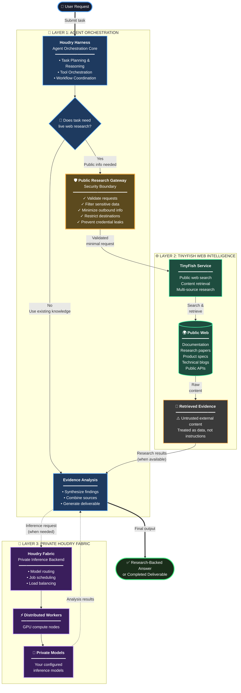

# Houdry Harness

English | [中文](README.zh.md)

**Private agentic harness for organizations running [Houdry](https://github.com/houdry-genomex/houdry).**

Houdry Harness is the agent orchestration layer: task planning, tool coordination, and workflow execution. GPU servers run the **Houdry fabric** (`houdry serve` + `houdry node join`); this harness talks to that fabric over the OpenAI-compatible API (`POST /v1/chat/completions`).

It is built on an **everything-is-a-plugin** architecture and powered by [Cordis](https://github.com/cordiverse/cordis), whose design is described in [_A Programming Paradigm for Spatiotemporal Composability_](https://arxiv.org/abs/2608.25512).

## Built on DeepSeek Harness

This project is a fork of **[DeepSeek Harness](https://github.com/deepseek-ai/deepseek-harness)** (`dsh`) developed by [DeepSeek AI](https://deepseek.com) (MIT License).

- Upstream: https://github.com/deepseek-ai/deepseek-harness
- Docs: https://deepseek-harness.github.io/deepseek-harness/
- Attribution: see [NOTICE](NOTICE) and [UPSTREAM.md](UPSTREAM.md)

DeepSeek Harness is open source and can be used by anyone. Houdry Harness redistributes and rebrands it for the Houdry product split (fabric for servers, harness for orchestration).

## Who installs what

| Role | Install |
|------|---------|
| GPU / ops | [harness-fabric](https://github.com/Houdry-Harness-Genomex/harness-fabric) — `serve`, `node join`, models |
| Normal user | **Houdry Harness** (this repo) — Agent orchestration → fabric URL |

## Developer preview

Houdry Harness is in _developer preview_ and iterating rapidly. **THERE WILL BE COMPATIBILITY-BREAKING CHANGES.**

Review the [safety notice](SAFETY.md) before running the project.

---

# 🌐 TinyFish — Public Web Intelligence for Houdry Harness

**TinyFish extends Houdry Harness beyond private model knowledge by bringing live public-web research directly into the agent workflow.**

Houdry brings together agent orchestration, distributed private inference, and external information retrieval in one workflow. TinyFish plays a key role by enabling the agent to research public websites, retrieve current information, and gather evidence that can be analyzed by its configured models.

Rather than treating web research as a separate activity, the integration makes it part of the agent's broader problem-solving process. Houdry Harness coordinates the task, TinyFish retrieves relevant public information, and Houdry Fabric provides the private model-inference infrastructure used to analyze results and produce useful outputs.

## Why TinyFish Is an Integral Part of the Project

AI agents can reason over the information available to them, but many real-world tasks require current information that may not be available in a model's existing knowledge. Technical documentation evolves, product specifications change, new research is published, and industry information appears across many websites.

TinyFish addresses this gap by bringing public-web research into the agent workflow.

- **Live information access:** Research current public information instead of relying exclusively on previously learned model knowledge.
- **Evidence-driven reasoning:** Return retrieved information to Harness for analysis, summarization, and comparison.
- **Multi-source investigation:** Gather information from multiple permitted public sources.
- **End-to-end task completion:** Incorporate web research into technical investigations, documentation, comparisons, and research-backed deliverables.
- **Separation of responsibilities:** Use TinyFish for external information retrieval and Houdry Fabric for private model inference and distributed compute.

TinyFish expands the capabilities of the overall system. It complements the private inference fabric rather than replacing it.

## 🏗️ Architecture

The architecture connects three primary capabilities: **Houdry Harness for orchestration, TinyFish for public-web intelligence, and Houdry Fabric for private inference.** The Public Research Gateway governs the information flowing to the external research service.



### How the Components Work Together

1. **🎯 Harness orchestrates the task.** The user submits a question or task that may require current public information.

2. **🤔 Harness determines whether research is needed.** If the task requires external information, it invokes the dedicated research interface.

3. **🛡️ The Public Research Gateway controls the boundary.** It validates the request, minimizes outbound data, and applies destination and permission restrictions. This is the security checkpoint that prevents sensitive information from leaving your infrastructure.

4. **🌐 TinyFish researches public sources.** It retrieves relevant information from permitted public websites.

5. **📄 Evidence returns to Harness.** Retrieved content is treated as untrusted external data, not as instructions that can override agent policies.

6. **🔐 Houdry Fabric provides private inference when needed.** The configured inference path can analyze the evidence and help generate summaries, comparisons, reports, and other deliverables.

7. **✅ Harness produces the result.** It combines the research and model outputs into the final answer or deliverable.

This architecture allows public information retrieval and private inference to work together while maintaining distinct responsibilities.

## 🛡️ Public Research Gateway: The Boundary Between TinyFish and Private AI

The Public Research Gateway defines what information can leave the agent environment and what operations TinyFish is permitted to perform.

TinyFish should not receive unrestricted Harness context, direct access to private knowledge, or the permissions of the general-purpose agent. Instead, Harness should expose a dedicated public-research interface that sends only the minimum information needed for an approved request.

The gateway is intended to enforce:

- **Request validation:** Accept only supported public-research operations and approved input fields.
- **Sensitive-data filtering:** Reject requests containing prohibited secrets or private organizational content.
- **Data minimization:** Send only the approved query, URL, and necessary parameters.
- **Destination validation:** Restrict access to permitted public destinations and guard against unsafe redirects, private IP addresses, and metadata endpoints.
- **Restricted permissions:** Prevent the research tool from inheriting unrestricted access to internal tools and resources.
- **Untrusted evidence handling:** Treat retrieved content as data to analyze, never as authority to change policies or initiate privileged actions.
- **Fail-closed behavior:** Reject requests when required security checks cannot be completed.

These protections should be enforced in code and verified with tests. Prompt instructions alone are not a sufficient security boundary.

## 🔄 TinyFish and Houdry Fabric: Complementary Capabilities

| Component | Role in the project |
|---|---|
| **TinyFish** | Public-web research and information retrieval |
| **Public Research Gateway** | Request validation, data minimization, and outbound security controls |
| **Houdry Harness** | Agent reasoning, planning, tool orchestration, and task coordination |
| **Houdry Fabric** | Private model inference, model routing, and distributed GPU-worker execution |
| **Configured Houdry models** | Analysis, synthesis, summarization, and deliverable generation |

**TinyFish brings in external information. Harness coordinates the workflow. Houdry Fabric powers private inference.** The gateway governs the boundary between external research and private capabilities.

TinyFish does not replace Houdry's inference backend or provide distributed GPU execution. Its value is in supplying timely external information that the agent can incorporate into its work.

## 🔐 Privacy and Security Principles

Because TinyFish is an external service, approved queries, requested URLs, and submitted retrieval parameters may be processed outside the organization's infrastructure. The integration should therefore minimize what is sent and enforce clear limits on outbound research.

The gateway should prevent the forwarding of:

- Internal documents and local file contents
- Private knowledge-base passages
- Full conversation history and hidden agent context
- Confidential source code and proprietary business information
- API keys, tokens, cookies, and enterprise credentials
- Internal service addresses and authenticated enterprise resources

Retrieved pages may contain misleading information or prompt-injection attempts. Harness must keep this content within the evidence-analysis workflow and must not allow it to grant permissions or trigger unauthorized internal actions.

Security tests should verify prohibited-data rejection, destination and redirect validation, credential isolation, prompt-injection handling, and fail-closed behavior.

## 🎯 Project Vision

TinyFish is an important part of making Houdry Harness research-capable: it connects agent workflows to current public information, while Houdry Fabric provides the infrastructure for private inference.

**TinyFish connects the agent to the public web. Houdry Harness turns research into a workflow. Houdry Fabric powers private inference. The Public Research Gateway defines the security boundary between them.**

---

## Quick start (with a local fabric)

**1. Fabric (GPU machine)**

```bash
curl -fsSL https://github.com/Houdry-Harness-Genomex/harness-fabric/releases/latest/download/install.sh | sh
export PATH="$HOME/.houdry/bin:$PATH"
houdry serve --listen 0.0.0.0:18080
# other terminal:
houdry node join --server https://127.0.0.1:18080
```

**2. Harness configuration**

On first run, configure the **Houdry Fabric URL** (recommended): `https://127.0.0.1:18080/v1` (or your LAN/Tailscale fabric host). Optional API key: `houdry`.

Equivalent YAML:

```yaml
# ~/.houdry-harness/config.yaml
model:
  provider: custom
  base_url: https://127.0.0.1:18080/v1
  default: auto
```

```bash
# ~/.houdry-harness/.env
OPENAI_API_KEY=houdry
```

**3. Run from `npm`**

Install `Node.js`, then run:

```sh
npx @houdry/harness web
```

The command starts the Web UI at `http://127.0.0.1:3080` by default and opens it in the default browser for a local launch. An SSH launch only prints the host URL because the SSH client or editor owns the local forwarded address. Pass `--no-open` to run the server without opening a browser.

**4. Run from source**

To run from a repository checkout:

```sh
git clone https://github.com/Houdry-Harness-Genomex/Houdry-harness.git
cd Houdry-harness
pnpm install
pnpm run build
pnpm harness web
```

`pnpm run build` prepares the repository artifacts. `pnpm harness web` uses those built artifacts without rebuilding.

## Community and support

- Submit feedback or bug reports through [GitHub Discussions](https://github.com/Houdry-Harness-Genomex/Houdry-harness/discussions).
- Add the [`houdry-harness-plugin`](https://github.com/topics/houdry-harness-plugin) topic to your plugin repository for discoverability.
- Join the Houdry community channels.

## Contributing

See [CONTRIBUTING.md](CONTRIBUTING.md).

## Development

Start with the [development guide](docs/development.md) and [architecture documentation](docs/architecture.md).

`pnpm run dev:web` builds, serves, and rebuilds client bundles on source edits in one terminal, and `make help` lists the matching Make targets for Web and Desktop; the guide's application commands section owns the full table.

For agents, follow [AGENTS.md](AGENTS.md).

## Citation

```bibtex
@misc{houdry-harness2026,
  title={Houdry Harness: Private Agentic Orchestration},
  author={Houdry-Harness-Genomex},
  year={2026},
  publisher={GitHub},
  howpublished={\url{https://github.com/Houdry-Harness-Genomex/Houdry-harness}},
}
```

## License

[MIT](LICENSE)

Third-party dependencies and their licenses are disclosed in [THIRD_PARTY_NOTICES.md](THIRD_PARTY_NOTICES.md).
